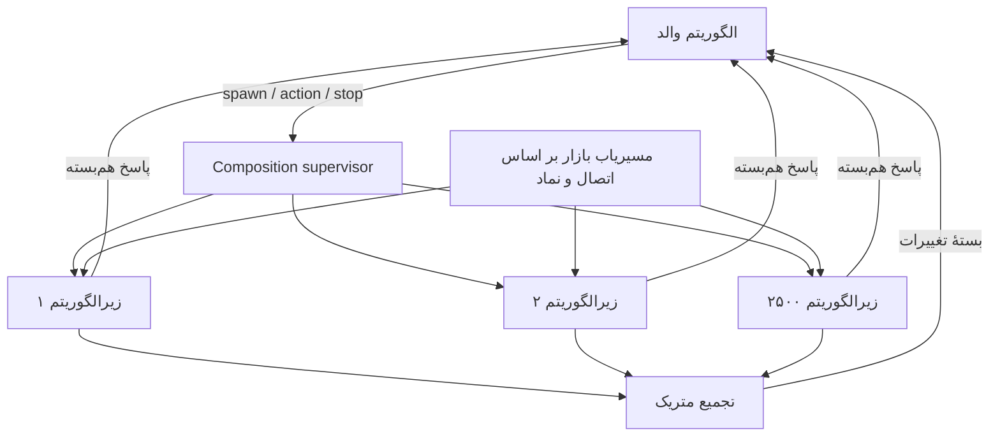

# بررسی میل‌باکس و طرح «الگوریتم در الگوریتم»

تاریخ: ۲۰ مهر ۱۴۰۵ / 2026-10-12

> بخش‌های ۱ تا ۸ وضعیت مبنای بررسی در ۱۲ اکتبر را توصیف می‌کنند. پیاده‌سازی بعدی در `nested-algorithms-implementation.md` گزارش شده است؛ توضیحات «فعلی» در این بخش‌ها به نسخهٔ پیش از تغییرات اشاره دارند.

## نتیجهٔ اصلی

۱. **هر اکتور میل‌باکس مستقل دارد.** در Local، صف پیام مشترک بین همهٔ اکتورها وجود ندارد؛ Executor و نخ‌های پردازش مشترک‌اند. صف کارِ Executor را نباید با میل‌باکس اکتورها یکی دانست.

۲. **اولویت در Local وجود دارد، اما فقط دو سطح عادی و فوری.** پیام دارای `UrgentMessage` جلوتر از پیام‌های عادیِ منتظر پردازش می‌شود. آکا نیز میل‌باکس اولویت‌دار دارد، ولی adapter فعلی پروژه این سیاست Local را به آکا منتقل نمی‌کند.

۳. **اجرای زیرالگوریتم‌ها در اکتورهای جدا قابل پیاده‌سازی است، اما فیچر کامل امروز آماده نیست.** ساخت child actor در framework موجود است؛ SDK الگوریتم، مالکیت فرزندان، پاسخ هم‌بسته، اشتراک متریک، توقف درختی و کنترل ظرفیت باید تکمیل شوند. برای اندروید، ادامهٔ مسیر Local پیشنهاد می‌شود. پشتیبانی از ۲۵۰۰ فرزند از نظر مدل اجرایی ممکن است، ولی با کد فعلی تضمین کارایی یا صحت آن قابل ارائه نیست.

گزارش کاربر مبنی بر پاسخ‌گویی یک اکتور به ۲۵۰۰ نماد، مبنای مقایسهٔ مطلوب است؛ در این بررسی این بار روی گوشی بازتولید نشده است. ۲۵۰۰ نماد در یک state با ۲۵۰۰ نمونهٔ کامل الگوریتم از نظر صف، state، متریک، journal و مسیریابی یکسان نیست.

## دامنه و روش بررسی

مبنای نتیجه، سورس موجود در `actor-framework`، `aat-engine`، `aat-common` و host واقعی اندروید در `AndroidAlgorithmTradingPlatform` است. مسیرها در جدول شواهد نسبت به همین روت `project-scope` هستند. این روت مجموعه‌ای از پروژه‌هاست و خودش مخزن Git نیست.

مستندات رسمی آکا و اندروید نیز بررسی شد. وابستگی آکا در پروژه **2.6.20** است؛ صفحات نسخهٔ 2.6 از ابزار وب قابل بازیابی نبودند، بنابراین برای توضیح قابلیت عمومی از مستندات رسمی موجود استفاده شده است. تنظیم دقیق نسخهٔ قفل‌شده باید با تست adapter تأیید شود. همچنین این بررسی تطابق باینری APK نصب‌شده یا تمام dependencyهای resolveشده با سورس محلی را اثبات نمی‌کند.

تست موجود `InMemoryMailboxTest` با دستور زیر اجرا شد: **۳ تست موفق، صفر شکست و خطا**. این تست‌ها حفظ پیام‌های جدید در overflow، رد ظرفیت نامعتبر و جلو افتادن پیام فوری را پوشش می‌دهند؛ آزمون ظرفیت اندروید نیستند.

```sh
cd actor-framework
mvn -pl actor-adapter-local -am test -Dtest=InMemoryMailboxTest -Dsurefire.failIfNoSpecifiedTests=false -q
```

## ۱. مالکیت صف و مدل پردازش فعلی

`LocalActorSystem.spawn`، `LocalActorContext.spawn`، `spawnPersistent` و `LocalShardRegion.createEntity` هر بار یک `InMemoryMailbox` جدید می‌سازند. هر ref پیام را به همان mailbox خود می‌فرستد. هر entity الگوریتم در shard نیز mailbox مستقل دارد.

در host واقعی اندروید، `LocalActorSystem` از `HostExecutors.getEngineExecutor()` استفاده می‌کند. تعداد workerهای این pool برابر `maxOf(2, availableProcessors())` است؛ ۲۵۰۰ اکتور به معنای ۲۵۰۰ نخ نیست. pool زمان‌بندی و pool اتصال‌ها جدا هستند.

در mailbox، پرچم اتمیک `scheduled` از پردازش هم‌زمان دو پیام همان اکتور جلوگیری می‌کند. هر نوبت حداکثر ۱۰ پیام مصرف و در صورت باقی‌ماندن پیام، کار دوباره زمان‌بندی می‌شود. این تقسیم نوبت به انصاف کمک می‌کند، ولی handler طولانی یا مسدودکننده همچنان worker را اشغال می‌کند. اولویت پیام نیز handler در حال اجرا را قطع نمی‌کند و اولویت بین اکتورها ایجاد نمی‌کند.

نکتهٔ مستندسازی: توضیح ابتدای `InMemoryMailbox` از `ConcurrentLinkedQueue` و lock-free بودن صحبت می‌کند، اما اجرای فعلی از **دو `ArrayDeque` و `synchronized(queueLock)`** استفاده می‌کند. نتیجهٔ این گزارش بر اساس کد اجرایی است.

## ۲. اولویت، ترتیب و سرریز

### رفتار واقعی Local

| وضعیت | رفتار فعلی |
|---|---|
| دریافت پیام فوری | قرار گرفتن در انتهای `urgentQueue` |
| انتخاب پیام بعدی | ابتدا اولین فوری، سپس اولین عادی |
| ترتیب در هر سطح | FIFO برای پیام‌های باقی‌مانده |
| صف پر + پیام عادی | حذف قدیمی‌ترین عادی و افزودن جدید؛ اگر همه فوری باشند، حذف پیام عادی ورودی |
| صف پر + پیام فوری | حذف قدیمی‌ترین عادی؛ اگر همه فوری باشند، حذف قدیمی‌ترین فوری |
| mailbox متوقف | رهاکردن پیام بدون اعلام به فرستنده |

ظرفیت مجموع دو صف محدود است؛ مقدار پیش‌فرض framework برابر ۱۰۰۰ و مقدار host واقعی اندروید **۲۰۰۰ برای هر اکتور** است. ظرفیت قابل تنظیم به تفکیک نوع اکتور در API فعلی دیده نمی‌شود.

این سیاست فقط برای داده‌ای که از دست رفتن نسخهٔ قدیمی آن پذیرفتنی است مناسب است. پیام عادی الزاماً market data نیست: action، پاسخ، رخداد سفارش یا تغییر تنظیمات نیز می‌تواند عادی باشد. بنابراین نباید حذف قدیمی‌ترین پیام را تضمین حفظ صحت معاملات تلقی کرد. حتی برای market data، حذف عمومی FIFO با نگه‌داشتن آخرین مقدار **هر نماد** متفاوت است.

`EngineClientPortImpl.sendGeneralAgentAction` فقط action با کد `STOP` را به `UrgentAgentCommand` تبدیل می‌کند. در مقابل `killAllAgents()` از `StopCommand` استفاده می‌کند که `UrgentMessage` نیست؛ پس این مسیر توقف اولویت همان STOP معمولی UI را ندارد. علاوه بر این، فراوانی پیام فوری می‌تواند پردازش عادی را عقب بیندازد.

### آکا و شکاف adapter

آکا mailbox مستقل برای هر actor دارد و از mailboxهای priority و control-aware پشتیبانی می‌کند. نوع stable ترتیب FIFO در اولویت مساوی را نگه می‌دارد؛ نوع priority غیرstable چنین تضمینی ندارد. انتخاب mailbox در Typed با `MailboxSelector` و تنظیمات انجام می‌شود. برای صف محدود، ارسال نباید با انتظار مسدودکننده روی workerها همراه شود. [مستند رسمی mailbox آکا](https://doc.akka.io/libraries/akka-core/current/typed/mailboxes.html)

در کد این پروژه، `AkkaActorSystemAdapter` با `Props.empty()` و `AkkaActorContextAdapter` بدون selector فرزند می‌سازند. marker اختصاصی `UrgentMessage` نیز خودبه‌خود `akka.dispatch.ControlMessage` نیست. `defaultMailboxCapacity` به این spawnها اعمال نشده است. بنابراین انتقال به آکا به‌تنهایی همان ظرفیت ۲۰۰۰، همان اولویت یا همان سیاست overflow را ایجاد نمی‌کند؛ پیکربندی بیرونی احتمالی آکا نیز باید جداگانه بررسی شود.

پیشنهاد: `ActorOptions/MailboxPolicy` مشترک به API اضافه شود و هر adapter آن را صریح نگاشت کند. تست قراردادی ترتیب، ظرفیت و نتیجهٔ پذیرش پیام برای هر دو adapter الزامی باشد؛ تغییر نام adapter نباید رفتار قابل مشاهده را بی‌صدا عوض کند.

## ۳. امکانات و موانع «الگوریتم در الگوریتم»

### اجزای قابل استفاده

- framework دارای `ActorContext.spawn` و `spawnPersistent` و ارسال غیرهم‌زمان با `ActorRef.tell` است.
- اینجین هر نمونهٔ الگوریتم را در `AgentFacadePersistentActor` اجرا می‌کند و شناسهٔ نمونه، action، RequestId، event، metric و registry الگوریتم دارد.
- Local از `PersistentBehaviorWithContext` پشتیبانی می‌کند، اما facade فعلی فقط `PersistentBehavior` را پیاده‌سازی کرده است. صرف وجود context در framework به معنی در دسترس بودن spawn در SDK نیست.
- `Agent` به dispatcher دسترسی دارد و می‌تواند پیام ارسال کند، ولی API اختصاصی ساخت و مالکیت child، مشاهدهٔ مرگ فرزند، correlation پاسخ و subscribe متریک ندارد.

### موانع مشخص پیش از توسعهٔ مقیاس‌پذیر

| مانع | اثر عملی و اقدام لازم |
|---|---|
| توقف ناقص درخت Local | cell هنگام stop فقط mailbox خود را متوقف می‌کند؛ `context.stop` نیز تنها یک mailbox را می‌بندد. توقف بازگشتی، unsubscribe، پاک‌سازی و اعلان termination اضافه شود. |
| نام child تکراری | `children.put` مرجع قبلی را جایگزین می‌کند؛ actor قبلی لزوماً متوقف نمی‌شود. ایجاد باید اتمیک و تکرار درخواست idempotent باشد. |
| ناسازگاری کلید child پایدار | ثبت با `childName` انجام می‌شود ولی stop از `child.path().name()` استفاده می‌کند؛ path از identity ترکیبی ساخته شده و می‌تواند نام دیگری داشته باشد. registry باید با شناسهٔ ثابت/ref تطبیق دهد. |
| هویت persistence | cell از `behavior.identity()` استفاده می‌کند، نه صرفاً identity ساخته‌شده در context؛ factory فعلی فقط `childName` می‌گیرد. تضمین یکتایی parent/child باید به قرارداد factory افزوده شود. |
| supervision محدود | RESTART اکتور عادی Local factory را دوباره اجرا نمی‌کند؛ ESCALATE سلسله‌مراتب کامل اعلان به والد ندارد. restart واقعی و اعلان failure لازم است. |
| خاموشی ناقص system | `LocalActorSystem.terminate` فقط top-levelها را می‌بندد و executor را shutdown می‌کند؛ پیمایش shard regionها و فرزندان در این مسیر دیده نمی‌شود. |
| پخش داده بر اساس connection | `AgentEventHandler` هر ConnectorEvent را به تمام instanceهای ثبت‌شده روی آن connection می‌فرستد؛ فیلتر نماد در این نقطه نیست. |
| متریک مشترک | `EngineApplication` و `GeneralAgentEventHandler` از HashMap مشترک استفاده می‌کنند و dispatcher مستقیم روی نخ فراخوان اجرا می‌شود؛ برای چند actor، مالکیت state یا هم‌زمانی ایمن لازم است. |
| replay و side effect | `onEvent` facade، handler الگوریتم و loop را صدا می‌زند؛ افزودن spawn/action خارجی به این مسیر می‌تواند هنگام replay تکرار شود. |
| persistence اندروید | host از `InMemoryEventStore` و `InMemorySnapshotStore` استفاده می‌کند؛ مرگ process آن‌ها را از بین می‌برد. snapshot فعلی reference همان state را نگه می‌دارد، نه نسخهٔ immutable مستقل. |

این موارد عمدتاً از مسیرهای کد استنتاج شده‌اند؛ به‌جز رفتارهای تست mailbox، بازتولید اجرایی همهٔ خطاها در این کار انجام نشده است. `AkkaActorContextAdapter.getChild` نیز فعلاً `null` برمی‌گرداند؛ برابری تمام قابلیت‌های Local و Akka نباید فرض شود.

## ۴. معماری پیشنهادی

### تصمیم پایه

برای نسخهٔ اول، **مالکیت منطقی درخت الگوریتم‌ها در اینجین** نگهداری شود و هر child یک entity مستقل با شناسهٔ پایدار باشد. والد از طریق یک port محدود SDK آن را مدیریت کند. این مسیر از registry، routing و facade فعلی استفاده می‌کند و به درخت فیزیکیِ ناقص Local وابسته نمی‌شود. توقف درخت منطقی باید توسط supervisor اینجین تضمین شود؛ صرف استفاده از shard این تضمین را ایجاد نمی‌کند.

اگر نیاز واقعی فرزند صرفاً محاسبهٔ سبک روی یک نماد باشد، همان قرارداد lifecycle با runtime غیرpersistent قابل ارائه باشد. تکثیر facade کامل و journal برای هر worker محاسباتی ضرورت ندارد. والد و فرزند همچنان actor جدا و mailbox مستقل دارند. الگوریتم کامل می‌تواند فرزندان خودش را نیز بسازد، با محدودیت عمق و تعداد کل درخت.



### قرارداد SDK پیشنهادی

نام‌ها طرح API هستند و امروز در پروژه وجود ندارند:

```java
interface ChildAlgorithms {
    void spawn(SpawnChild request);
    void send(ChildAction request);
    void subscribeMetrics(MetricSubscription request);
    void stop(StopChild request);
    void stopAll(StopChildren request);
}
```

این API مسدودکننده نیست؛ completion در قالب پیام به mailbox والد بازمی‌گردد. SDK به actor context خام، executor یا state فرزند دسترسی نمی‌دهد. callback شبکه نیز فقط پیام ارسال می‌کند و state الگوریتم را مستقیماً تغییر نمی‌دهد.

| پیام | فیلدهای ضروری |
|---|---|
| `SpawnChild` | parentId، childKey، algorithmCode و version، config، requestId، runtimeMode، limits |
| `ChildStarted/ChildStartFailed` | requestId، childId، generation، نتیجه یا علت |
| `ChildAction` | sourceId، targetId، generation، requestId، traceId، actionCode، payload، deadline |
| `ChildActionResult` | requestId، childId، generation، accepted/completed/rejected/failed و payload |
| `ChildMetricBatch` | childId، generation، sequence، timestamp، metricCode/valueهای تغییرکرده |
| `ChildStopped/ChildFailed` | childId، generation، علت، آخرین وضعیت شناخته‌شده |

`childId` از parentId و childKey به‌صورت بدون تصادم ساخته شود؛ چسباندن رشته‌ها با جداکنندهٔ مبهم کافی نیست. generation با هر incarnation افزایش یابد تا پاسخ actor قبلی وارد state جدید نشود. تکرار spawn با همان requestId و مشخصات، همان نتیجه را بدهد؛ همان key با تنظیم متناقض رد شود.

پذیرش action و تکمیل آن دو رخداد متفاوت‌اند. timeout فقط یعنی پاسخ تا deadline نرسیده، نه اینکه action اجرا نشده است. retry با همان requestId و dedup انجام شود؛ برای action سفارش، reconciliation با connector لازم است. تضمین «دقیقاً یک بار» صرفاً با ActorRef حاصل نمی‌شود.

### چرخهٔ عمر و مالکیت

حالت child: `CREATING → STARTING → RUNNING → STOPPING → STOPPED`؛ شکست به `FAILED` می‌رود. والد فقط پس از `ChildStarted` child را آماده تلقی کند. پیام قبل از آمادگی با حد محدود نگهداری یا صریحاً رد شود.

registry شامل rootId، parentId، childId، key، version، generation، status، subscriptions و limits باشد. فقط مالک یا مدیر مجاز بتواند action مدیریتی بفرستد. سقف تعداد مستقیم، تعداد کل descendants، عمق، نرخ spawn و pending request کنترل شود تا چند سطح nesting تعداد را بدون محدودیت افزایش ندهد.

توقف والد: ورود به STOPPING، جلوگیری از spawn/action جدید، توقف درخت از برگ‌ها، تعیین تکلیف سفارش‌های هر child، unsubscribe و آزادسازی timer، دریافت acknowledgment، سپس توقف والد. timeout فرزند وضعیت نامطمئن ایجاد می‌کند و باید گزارش و reconcile شود؛ توقف actor به معنای لغو سفارش broker نیست. رفتار stop نرم و kill اضطراری جدا تعریف شود.

supervisor مستقل باید پس از failure والد هم مالکیت فرزندان را بداند. restart با backoff و سقف تلاش انجام شود؛ failure یک child پیش‌فرض فقط همان child را ایزوله کند. خاموشی کل engine تمام regionها و registryها را پیش از بستن executor جمع کند.

### مسیر بازار و متریک

مسیریاب subscription با کلید `(connectionId, instrumentId, eventType)` ساخته شود. دادهٔ هر نماد مستقیم به علاقه‌مندان برسد؛ والد مسیر عبور اجباری تمام tickها نباشد. subscription اتصال با ref-count بین فرزندان مشترک شود؛ ۲۵۰۰ child نباید ۲۵۰۰ اتصال یکسان ایجاد کنند.

تنها snapshotهای قابل جایگزینی با کلید نماد/eventType ادغام شوند. رخداد fill، تغییر وضعیت سفارش و deltaهایی که به توالی قبلی وابسته‌اند حذف یا coalesce عمومی نشوند؛ gap باید با sequence تشخیص داده و resync شود.

متریک نمایشی latest-value و دوره‌ای، مثلاً هر ۲۵۰ تا ۱۰۰۰ میلی‌ثانیه، ارسال شود؛ مقادیر پیشنهادی قابل تنظیم‌اند. متریک محرک تصمیم معاملاتی قرارداد مستقل با سقف تأخیر مشخص داشته باشد. با ۲۵۰۰ child و ۱۰ متریک در ثانیه، ارسال تکی ۲۵۰۰۰ پیام در ثانیه به والد می‌سازد؛ batch، delta و تجمیع برای کنترل این هزینه لازم است. تاریخچه با retention محدود نگهداری شود.

### سیاست mailbox پیشنهادی

- مسیر کنترل و نتیجهٔ action ظرفیت رزروشده، نتیجهٔ پذیرش صریح و در صورت نیاز outbox پایدار داشته باشد؛ حذف بی‌صدا ممنوع شود.
- مسیر دادهٔ جایگزین‌پذیر bounded و keyed-coalescing باشد. افزایش capacity راه‌حل نرخ ورودی بیش از توان پردازش نیست.
- API مانند `tryTell → Accepted / Overloaded / Stopped` اضافه شود؛ Accepted فقط پذیرش در صف است و acknowledgment اجرای کسب‌وکار جداست.
- ظرفیت per actor و سقف کل پیام‌ها/حافظهٔ runtime اعمال شود. ابتدا ظرفیت ۶۴ یا ۱۲۸ برای worker سبک بررسی شود، سپس با اندازه‌گیری تنظیم گردد.
- توقف اضطراری اولویت ویژه داشته باشد؛ برای سایر کنترل‌ها سهم‌بندی پردازش جهت جلوگیری از گرسنگی data تعریف شود. ordering actionهای وابسته با sequence/version حفظ شود؛ priority نباید پاسخ را پیش از مقدمهٔ لازم قابل اجرا کند.
- handlerهای طولانی به کارهای کوتاه تقسیم شوند؛ I/O روی pool مجزا، با completion-message بازگردد. خطای rejection هنگام shutdown نباید mailbox را با `scheduled=true` برای همیشه رها کند.

### persistence و بازیابی

ساختار درخت، config، intentهای action حساس، dedup و وضعیت سفارش نیازمند durability هستند؛ raw tickها به‌طور پیش‌فرض journal نشوند. child محاسباتی با snapshot بازار و config قابل بازسازی باشد.

state بازیابی immutable/کپی‌شده باشد. `onEvent` فقط state را تغییر دهد؛ spawn، ارسال سفارش و callback از replay اجرا نشود. intent ثبت‌شده پس از recovery از طریق outbox و dedup اجرا/تطبیق داده شود. نسخهٔ الگوریتم و schema ثبت شود. پس از مرگ process، ابتدا وضعیت broker و سفارش‌ها reconcile و سپس پردازش معاملاتی فعال شود؛ نصب storage دیسکی به‌تنهایی مشکلات recovery فعلی facade را حل نمی‌کند.

## ۵. آیا ۲۵۰۰ فرزند روی اندروید عملی است؟

**پاسخ مشروط: بله برای workload مناسب و پس از اصلاحات؛ با شواهد فعلی تأییدشده نیست.** محدودیت اصلی تعداد نخ نیست، بلکه نرخ پیام ضربدر هزینهٔ handler، حجم state، backlog، GC و فعالیت پس‌زمینه است. استفاده از Local فعلی با pool محدود برای ارزیابی مناسب‌تر از افزودن وابستگی خوشهٔ آکا به گوشی است.

### برآوردهای عددی، نه نتیجهٔ benchmark

`ArrayDeque(capacity)` در ساخت mailbox عادی فضای reference متناسب با ظرفیت اولیه می‌گیرد. برای ۲۵۰۰ فرزند با ظرفیت ۲۰۰۰ حدود **۵ میلیون جای reference** فقط برای صف عادی در نظر گرفته می‌شود: حدود **۲۰ تا ۴۰ مگابایت ده‌دهی** با reference چهار یا هشت‌بایتی؛ بدون overhead آرایه‌ها، صف فوری، objectها و state. اندازهٔ واقعی ART و allocation باید اندازه‌گیری شود.

اگر صف‌ها پر شوند و متوسط payload اختصاصی هر پیام فرضاً ۲۵۶ بایت باشد، ۵ میلیون پیام حدود **۱٫۲۸ گیگابایت** payload می‌خواهد. این سناریوی بدبینانه با objectهای مستقل است؛ اشتراک immutable payload عدد را تغییر می‌دهد، اما envelopeها همچنان هزینه دارند. ظرفیت ۶۴ برای همان تعداد حدود ۱۶۰ هزار slot ایجاد می‌کند.

اگر بازار مجموعاً R رخداد در ثانیه داشته باشد و به تمام ۲۵۰۰ نمونهٔ یک connection ارسال شود، تعداد تحویل تا `2500 × R` رشد می‌کند. با routing نمادی و متوسط K علاقه‌مند، حدود `K × R` خواهد بود. تفاوت یک actor برای همهٔ نمادها و ۲۵۰۰ actor بدون اصلاح routing از اینجا می‌تواند بسیار بزرگ شود.

برای مثال فرضی، ۲۵۰۰ child هرکدام ۱۰ پیام در ثانیه یعنی ۲۵۰۰۰ پیام/ثانیه. handler متوسط ۵۰ میکروثانیه حدود ۱٫۲۵ core-second در ثانیه و handler یک میلی‌ثانیه حدود ۲۵ core-second در ثانیه می‌خواهد؛ قبل از serialization، GC و persistence. تقریب پایداری `ρ = λ × t / workers < 1` است، اما تأخیر tail و burst نیازمند حاشیهٔ ظرفیت‌اند و والدِ واحد همچنان تک‌مصرف‌کننده است.

### محدودیت‌های اندروید

پروژه `BackgroundService` دارد و manifest نوع `specialUse` را اعلام کرده است. باید start/stop سرویس، مرگ process، قطع شبکه، خاموشی صفحه، وضعیت باتری و محدودیت نسخه‌های Android روی دستگاه هدف بررسی شود. foreground service تضمین زنده‌ماندن نامحدود process یا دسترسی بی‌وقفه به منابع نیست. شروع سرویس از پس‌زمینه محدودیت دارد؛ `specialUse` نیز نیازمند declaration و توضیح use case است. [محدودیت شروع سرویس](https://developer.android.com/develop/background-work/services/fgs/restrictions-bg-start)، [انواع سرویس و specialUse](https://developer.android.com/develop/background-work/services/fgs/service-types#special-use)

قانون timeout شش‌ساعتهٔ dataSync نباید بی‌دلیل به سرویس specialUse فعلی تعمیم داده شود. تصمیم پشتیبانی ۲۵۰۰ child باید برای مدل دستگاه، نسخهٔ OS، مدت اجرا و SLA مشخص صادر شود.

## ۶. مراحل اجرا و معیار پذیرش

| مرحله | تغییر قابل تحویل | معیار خروج |
|---|---|---|
| صفر: baseline | ثبت trace همان ۲۵۰۰ نماد فعلی، نرخ ورودی، زمان handler، حافظه و افت پیام | workload قابل تکرار و دستگاه هدف مشخص |
| یک: runtime | اصلاح lifecycle، identity، duplicate spawn، shutdown، پذیرش پیام و متریک صف | تست stop درختی، restart، overflow و عدم باقی‌ماندن child |
| دو: composition | port SDK، supervisor، registry، correlation، quota و generation | والد بتواند دو الگوریتم متفاوت بسازد، action بدهد، پاسخ بگیرد و متوقف کند |
| سه: مقیاس | routing نماد، اشتراک اتصال، batch metrics، worker غیرpersistent و mailbox کوچک | رشد پیام با علاقه‌مندان واقعی؛ بدون broadcast ناخواسته |
| چهار: بازیابی | storage پایدار برای دادهٔ لازم، replay بدون side effect، dedup و reconciliation | kill/restart process بدون سفارش تکراری و بدون child یتیم |
| پنج: اندروید | آزمایش ۱، ۱۰۰، ۵۰۰، ۱۰۰۰، ۲۵۰۰ و burst تا ۵۰۰۰ child | تصویب ظرفیت واقعی با SLA توافق‌شده |

آزمون مقایسه‌ای روی release build و گوشی واقعی: A) یک actor با ۲۵۰۰ نماد، B) ۲۵۰۰ child محاسباتی، C) ۲۵۰۰ child کامل. دادهٔ ورودی و محاسبهٔ دامنه در هر سه یکسان باشد. idle، بار عادی، burst پنج‌برابری، child کند، والد کند، خرابی child، stop-all، disconnect/reconnect و فشار حافظه پوشش داده شود. تست ماندگاری حداقل یک جلسهٔ بازار برای سناریوی منتخب انجام شود.

شاخص‌ها: P50/P95/P99 تأخیر داده و action، زمان توقف کل، queue depth/age به تفکیک سطح، تعداد dropped/coalesced/rejected، pending request، CPU، heap/PSS، allocation/GC، thread count، توان مصرفی و throttling حرارتی. logging پرحجم باید در سنجش کنترل شود.

پیشنهاد اولیهٔ gate، نیازمند تأیید محصول: صفر حذف خاموش action/result/order event؛ صفر اجرای تکراری action حساس؛ صفر child یتیم پس از stop و cleanup؛ عدم رشد پیوستهٔ حافظه پس از warm-up؛ صف‌ها پس از burst به سطح پایدار برگردند. اعداد P99 و deadline توقف را پیش از benchmark از نیاز واقعی تعیین کنید؛ نتیجهٔ ظرفیت بدون این اعداد معنای مشخص ندارد.

## ۷. سؤال‌های باز برای نهایی‌کردن طرح

۱. «زیرالگوریتم» نمونهٔ کامل با سفارش، config و state مستقل است یا worker محاسباتی هر نماد؟ آیا ترکیب هر دو لازم است؟

۲. هر child فقط یک نماد را می‌بیند یا مجموعه‌ای از نمادها؟ نرخ واقعی و burst پیام برای هر نماد چقدر است و آیا همهٔ رخدادها باید پردازش شوند؟

۳. ۲۵۰۰ فرزند همگی دائماً فعال‌اند یا ایجاد تنبل/passivation پذیرفتنی است؟ nesting چند سطح و سقف کل درخت چقدر است؟

۴. P99 مجاز برای action، واکنش بازار، متریک تصمیم‌ساز و توقف اضطراری چند میلی‌ثانیه است؟

۵. متریک‌ها برای نمایش‌اند یا ورودی تصمیم والد؟ نرخ و retention مورد نیاز چیست؟

۶. مالک سفارش و بودجهٔ ریسک والد است یا هر child؟ توقف والد باید سفارش باز را لغو کند، مدیریت آن را منتقل کند یا فقط پردازش جدید را ببندد؟

۷. پس از failure والد، children باید متوقف شوند، ادامه دهند یا به supervisor دیگری واگذار شوند؟ restart و retry خودکار چه سقفی دارد؟

۸. پس از بسته‌شدن اپ/مرگ process، ادامهٔ خودکار مورد نیاز است؟ منبع حقیقت سفارش و state کدام است؟

۹. گوشی‌های حداقل هدف، RAM، نسخهٔ Android، مدت اجرای پس‌زمینه و محدودیت مصرف باتری چیست؟

۱۰. آیا childها در UI مستقل نمایش داده شوند یا فقط زیر والد؟ اجازهٔ action مستقیم کاربر به child چگونه باشد؟

۱۱. آیا حفظ سازگاری کامل Local/Akka همین نسخه لازم است؟ آیا اجرای server-side جایگزین برای دستگاه‌های ضعیف مجاز است؟

## ۸. فهرست شواهد سورس

مسیرها نسبت به روت این مستند هستند؛ نام متدها برای بازیابی بعد از تغییر خطوط آورده شده‌اند.

| فایل | شاهد |
|---|---|
| `actor-framework/actor-adapter-local/src/main/java/io/github/sohrabhs/local/InMemoryMailbox.java` | `enqueue`، `poll`، `processMessages`؛ دو صف، ظرفیت و batch ده‌تایی |
| `actor-framework/actor-adapter-local/src/main/java/io/github/sohrabhs/local/LocalActorSystem.java` | `spawn`، `initShardRegion`، `terminate` |
| `actor-framework/actor-adapter-local/src/main/java/io/github/sohrabhs/local/LocalActorContext.java` | `spawn`، `spawnPersistent`، `stop` و registry children |
| `actor-framework/actor-adapter-local/src/main/java/io/github/sohrabhs/local/LocalShardRegion.java` | ساخت mailbox مستقل هر entity و `stopAll` |
| `actor-framework/actor-adapter-local/src/main/java/io/github/sohrabhs/local/LocalActorCell.java` | رفتار stop و RESTART عادی |
| `actor-framework/actor-adapter-local/src/main/java/io/github/sohrabhs/local/LocalPersistentActorCell.java` | identity، recovery، snapshot و تزریق context |
| `actor-framework/actor-adapter-local/src/main/java/io/github/sohrabhs/local/InMemorySnapshotStore.java` | نگهداری reference state |
| `actor-framework/actor-adapter-akka/src/main/java/io/github/sohrabhs/akka/AkkaActorSystemAdapter.java` | Props و عدم نگاشت ظرفیت؛ استفاده از persistence خود آکا |
| `actor-framework/actor-adapter-akka/src/main/java/io/github/sohrabhs/akka/AkkaActorContextAdapter.java` | spawn بدون mailbox selector و getChild |
| `actor-framework/actor-adapter-akka/pom.xml` | نسخهٔ آکا 2.6.20 |
| `aat-engine/aat-engine-core/src/main/java/aat/engine/agent/AgentFacadePersistentActor.java` | lifecycle، persist interaction، onEvent و recovery |
| `aat-engine/aat-engine-core/src/main/java/aat/engine/service/EngineClientPortImpl.java` | ساخت instance، loop همهٔ نمونه‌ها، STOP فوری و killAll عادی |
| `aat-engine/aat-engine-core/src/main/java/aat/engine/event/handler/AgentEventHandler.java` | fan-out بر اساس connection |
| `aat-engine/aat-engine-core/src/main/java/aat/engine/event/handler/GeneralAgentEventHandler.java` | ثبت متریک در HashMap مشترک |
| `aat-common/src/main/java/ir/aat/common/port/agent/sdk/Agent.java` | سطح API فعلی الگوریتم |
| `aat-common/src/main/java/ir/aat/common/infrastructure/messaging/impl/GeneralMessageDispatcher.java` | فراخوان مستقیم dispatcherها روی نخ caller |
| `AndroidAlgorithmTradingPlatform/backend-real-host/src/commonMain/kotlin/ir/aat/app/backend/host/RealBackendHost.kt` | LocalActorSystem، ظرفیت ۲۰۰۰ و storeهای حافظه‌ای |
| `AndroidAlgorithmTradingPlatform/backend-real-host/src/commonMain/kotlin/ir/aat/app/backend/host/HostExecutors.kt` | pool مشترک با تعداد worker محدود |
| `AndroidAlgorithmTradingPlatform/app/src/main/AndroidManifest.xml` | foreground service از نوع specialUse |
| `actor-framework/actor-adapter-local/src/test/java/io/github/sohrabhs/local/InMemoryMailboxTest.java` | سه تست اجراشدهٔ mailbox |

در مرحلهٔ نخست فقط بررسی و طراحی انجام شد. پس از درخواست دوم، runtime و SDK نیز تغییر کردند؛ گزارش پیاده‌سازی را جداگانه ببینید.

## ۹. نیازمندی‌های تکمیلی پیاده‌سازی (درخواست دوم)

- Local با mailbox مستقل، اجرای سریالی هر actor، pool مشترک و lifecycle سلسله‌مراتبی به مدل آکا نزدیک بماند؛ بدون thread اختصاصی هر actor و بدون وابستگی آکا در Android.
- تمام actionها، پاسخ action و metricهای تبادل‌شده اولویت بالا داشته باشند. اولویت با fairness همراه باشد؛ به معنی preemption یا اجرای موازی state یک actor نیست.
- پیام پذیرفته‌شده برای جا دادن پیام دیگر حذف نشود. ظرفیت محدود و overload صریح باشد. تضمین پذیرش نامحدود، حافظه محدود و فرستندهٔ بدون کنترل فشار هم‌زمان ممکن نیست. فرستنده باید rejection را مدیریت کند؛ پذیرش در RAM تضمین دوام پس از crash نیست.
- تعداد workerها متناسب با CPU میزبان و قابل تنظیم باشد؛ actorها برای استفاده از هسته‌ها مستقل اجرا شوند و I/O روی pool جدا بماند.
- سازگاری الگوریتم‌های بدون فرزند با APIهای افزایشی و تست regression حفظ شود؛ childها از مسیر فعلی بارگذاری الگوریتم استفاده کنند.
- اصلاحات پایه پیش از فیچرها کامیت شوند؛ نمونهٔ actor، نمونهٔ الگوریتم و مستندات اجرایی اضافه شوند. PRهای وابسته ترتیب merge/build روشن داشته باشند.
- «رفع ایرادات» با تست و شواهد محدود به ایرادات کشف‌شده و مسیرهای تحت بررسی گزارش شود؛ ادعای اثبات نبود تمام خطاهای احتمالی در همهٔ مخازن صحیح نیست.
